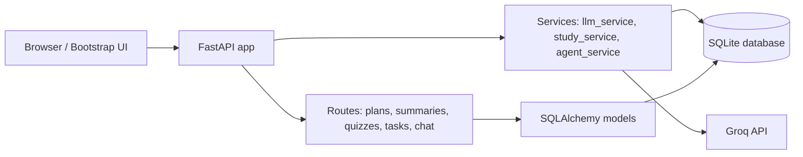

# AI Study & Task Assistant

A local-first productivity web app built with FastAPI, SQLAlchemy, SQLite, Bootstrap, and Groq-powered AI features. The app helps users generate study plans, summarize notes, create quizzes, manage tasks, and chat with an agent that can call Python tools to create and update tasks.

## Features

- AI study plan generation with structured, day-by-day recommendations
- AI notes summarization in multiple styles
- AI quiz generation from pasted study material
- Task management with create, view, complete, and delete operations
- AI assistant chat with tool-calling support for real task actions
- Local SQLite persistence
- Responsive dashboard and dark-light polished UI

## Project architecture



## GenAI vs agentic AI in this project

This project demonstrates two layers of AI:

- Generative AI: the app sends prompts to Groq to generate study plans, summaries, and quizzes.
- Agentic AI: the assistant can choose function calls such as create_task(), get_tasks(), complete_task(), and generate_study_plan() to act on real application data.

The tools are real Python functions connected to SQLite, not hardcoded mock responses. This keeps the agent grounded in actual task records and application behavior.

## How LLM tool calling works

The agent sends a chat request to Groq with a tools schema describing the Python functions it is allowed to call. When a user asks the assistant to create or update a task, the model may decide to call a tool instead of generating a plain text answer. The backend executes the actual function, then sends the tool result back to the model for the final reply.

## Directory structure

```text
ai-study-assistant/
├── app/
│   ├── __init__.py
│   ├── config.py
│   ├── database.py
│   ├── main.py
│   ├── models.py
│   ├── schemas.py
│   ├── routers/
│   │   ├── __init__.py
│   │   ├── chat.py
│   │   ├── plans.py
│   │   ├── quizzes.py
│   │   ├── summaries.py
│   │   └── tasks.py
│   ├── services/
│   │   ├── __init__.py
│   │   ├── agent_service.py
│   │   ├── llm_service.py
│   │   └── study_service.py
│   ├── static/
│   │   ├── css/
│   │   │   └── style.css
│   │   └── js/
│   │       └── app.js
│   └── templates/
│       ├── base.html
│       ├── chat.html
│       ├── dashboard.html
│       ├── plans.html
│       ├── quiz.html
│       ├── summarizer.html
│       └── tasks.html
├── tests/
│   └── test_app.py
├── .env.example
├── .gitignore
├── requirements.txt
├── README.md
├── ai_study_assistant.db
└── test_ai_study_assistant.db
```

## Prerequisites

- Python 3.11+
- Windows 10 or 11
- A Groq API key

## Windows PowerShell setup

```powershell
cd "C:\path\to\AI Study Assistant"
python -m venv .venv
.\.venv\Scripts\Activate.ps1
pip install -r requirements.txt
Copy-Item .env.example .env
```

## Groq API key setup

Add your Groq credentials to `.env`:

```env
GROQ_API_KEY=your_groq_api_key_here
GROQ_MODEL=llama-3.3-70b-versatile
```

You can create an account on Groq and generate an API key from the Groq console. The app will still start without a key, but AI features will return a helpful configuration message until the key is added.

## Run the app

```powershell
.\.venv\Scripts\Activate.ps1
uvicorn app.main:app --reload
```

Open the app at:

```text
http://127.0.0.1:8000
```

The OpenAPI docs are available at:

```text
http://127.0.0.1:8000/docs
```

## Run tests

```powershell
.\.venv\Scripts\Activate.ps1
python -m pytest -q
```

## Common errors and fixes

### ModuleNotFoundError: fastapi

Run:

```powershell
pip install -r requirements.txt
```

### No such table: tasks

Delete stale local SQLite files and restart the app:

```powershell
Remove-Item .\ai_study_assistant.db
```

### AI features fail with a configuration message

Check that `.env` contains a valid `GROQ_API_KEY` and `GROQ_MODEL`.

### 404 on the dashboard

Make sure you started the app from the project root and ran:

```powershell
uvicorn app.main:app --reload
```

## Future improvements

- Add user accounts and per-user isolation
- Add AI-generated session notes and task suggestions
- Add password-protected local auth
- Add calendar views and due-date reminders
- Add broader agent workflows and research tools

## Local use note

This application is intended for local use and does not provide user authentication or isolation. It is designed for a single machine or a local development environment, not a production multi-user deployment.
